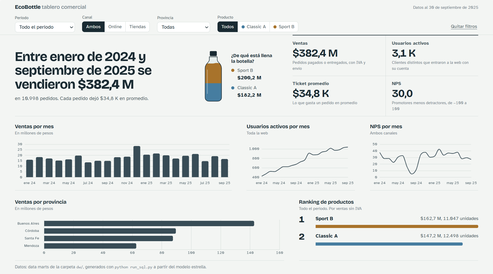
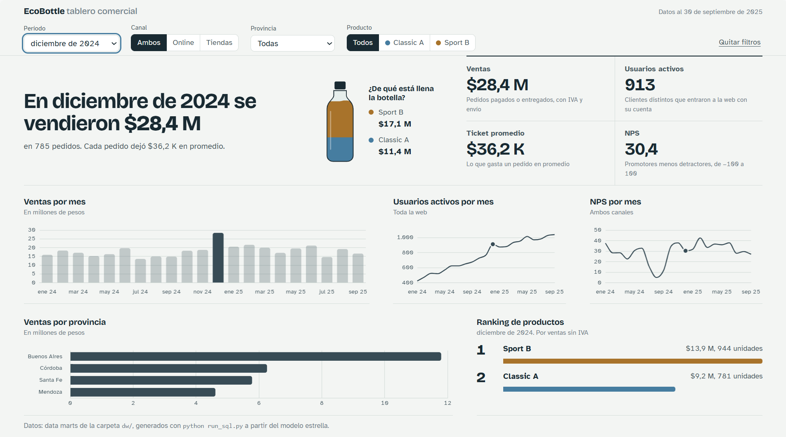
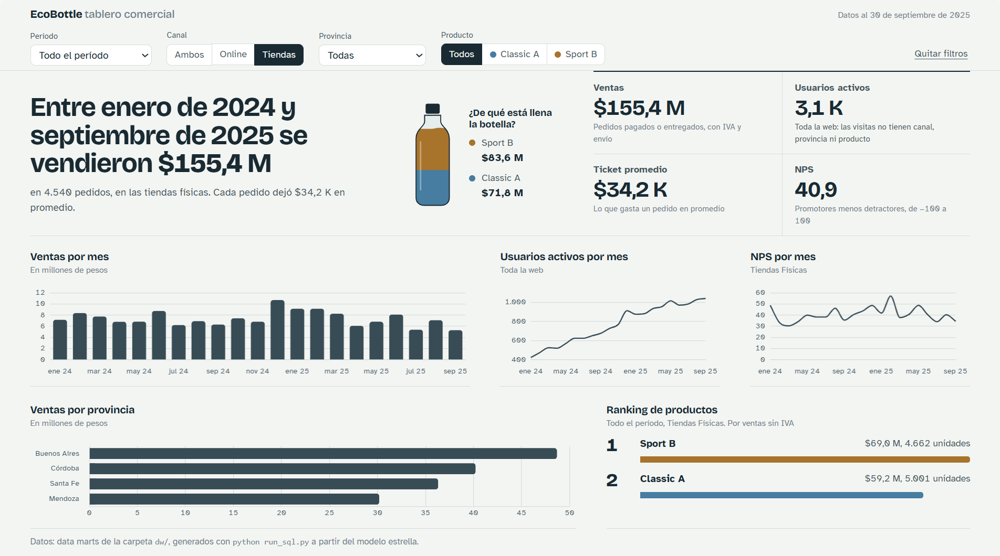
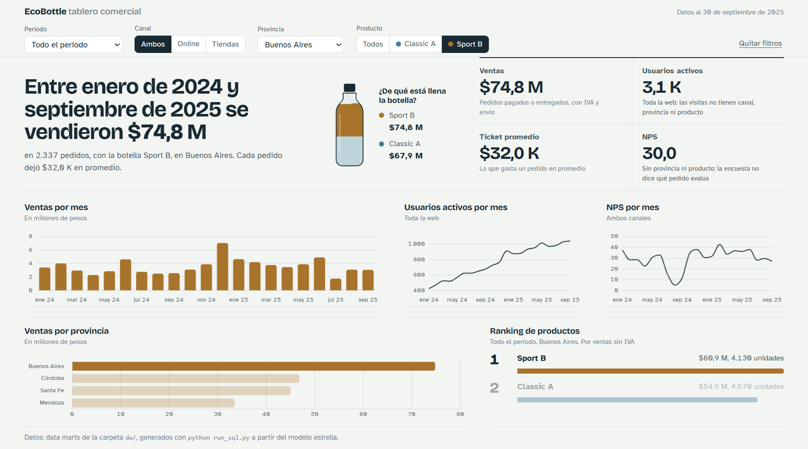

# EcoBottle AR: tablero comercial

Datos de ventas online y en tiendas transformados con SQL en un modelo estrella y data marts, y mostrados en un tablero web.

**Tablero:** https://benilozano2007.github.io/practica-imond/



| Diciembre de 2024 | Tiendas físicas | Sport B en Buenos Aires |
|---|---|---|
|  |  |  |

## Problema

Los datos del sistema de ventas (OLTP) están normalizados en 13 tablas y mezclan ventas con pedidos cancelados. El proyecto los convierte en KPIs confiables y calculados en un solo lugar: ventas, usuarios activos, ticket promedio, NPS, ventas por provincia y ranking de productos.

## Arquitectura

```
raw/ ─► SQL (ELT con DuckDB) ─► modelo estrella ─► data marts ─► dw/*.csv ─► tablero web ─► GitHub Pages
```

- **ELT:** los datos se cargan tal como vienen y se transforman con SQL dentro de la base.
- **Idempotente:** `run_sql.py` reconstruye todo desde cero en cada ejecución.
- **Cálculos en los marts:** el tablero solo muestra valores ya calculados.
- **Según lo indicado en clase:** las transformaciones se hacen en SQL (no en Python) y el tablero es un sitio web en GitHub Pages (no Power BI ni Looker Studio).

## Ejecución

```bash
git clone https://github.com/BeniLozano2007/practica-imond.git
cd practica-imond
python -m venv .venv
.venv\Scripts\activate          # Mac / Linux: source .venv/bin/activate
pip install -r requirements.txt
python run_sql.py               # arma el data warehouse y exporta dw/
python run_sql.py --ui          # opcional: explorar las tablas en el navegador
python -m http.server           # opcional: ver el tablero en http://localhost:8000
```

## Estructura

| Ruta | Contenido |
|---|---|
| `raw/` | Datos de origen (no se modifican) |
| `sql/01a_*`, `sql/01b_*` | Dimensiones |
| `sql/02a_*` a `sql/02d_*` | Hechos |
| `sql/03_consultas.sql` | Controles y KPIs |
| `sql/04a_*` a `sql/04d_*` | Data marts |
| `dw/` | Data warehouse en CSV y diagrama del modelo |
| `index.html`, `style.css`, `app.js` | Tablero web |
| `assets/` | DER de origen y capturas |

## Modelo estrella

Diagrama: [`dw/modelo_estrella.md`](dw/modelo_estrella.md).

| Hecho | Grano: una fila representa… |
|---|---|
| `fact_sales_order` | un pedido de un cliente, en un canal, en una fecha (incluye pago y envío, 1 a 1) |
| `fact_sales_order_item` | un producto dentro de un pedido |
| `fact_web_session` | una visita a la web, de un cliente o anónima |
| `fact_nps_response` | una respuesta a la encuesta NPS, en un canal, en una fecha |

## Diccionario de datos

### Dimensiones

| Tabla | Columnas |
|---|---|
| `dim_date` | `date_key` (AAAAMMDD), `date`, `year`, `month`, `month_name`, `day`, `weekday` |
| `dim_channel` | `channel_id`, `code` (ONLINE / OFFLINE), `name` |
| `dim_customer` | `customer_id`, `first_name`, `last_name`, `status` (A activo / I baja), `created_at` |
| `dim_address` | `address_id`, `city`, `province`, `postal_code` |
| `dim_store` | `store_id`, `name`, `city`, `province` |
| `dim_product` | `product_key` (clave subrogada), `product_id`, `sku`, `name`, `category`, `family`, `list_price` (sin IVA) |

### Hechos

| Tabla | Columnas |
|---|---|
| `fact_sales_order` | `order_id`, `date_key`, `customer_id`, `channel_id`, `store_id` (vacío si es online), `shipping_address_id`, `order_date`, `status`, `is_sale` (PAID o FULFILLED), `subtotal`, `tax_amount` (IVA 21 %), `shipping_fee`, `total_amount`, `payment_method`, `payment_status`, `paid_at`, `shipment_status`, `shipped_at`, `delivered_at` |
| `fact_sales_order_item` | `order_item_id`, `order_id`, `product_key`, `date_key`, `customer_id`, `channel_id`, `is_sale`, `quantity`, `unit_price`, `discount_amount`, `line_total` (sin IVA) |
| `fact_web_session` | `session_id`, `date_key`, `customer_id` (vacío si es anónimo), `started_at`, `ended_at`, `source` (ads, direct, referral, organic), `device` (mobile, desktop, tablet) |
| `fact_nps_response` | `nps_id`, `date_key`, `customer_id` (vacío si es anónima), `channel_id`, `responded_at`, `score` (0 a 10), `is_promoter` (9-10), `is_detractor` (0-6) |

### Data marts

Los valores **Todos** / **Todas** representan el total de ese filtro.

| Tabla | Una fila es… | Métricas |
|---|---|---|
| `mart_ventas_mensual` | mes + canal + provincia + producto | `pedidos`, `unidades`, `ventas`, `ticket_promedio` |
| `mart_usuarios_activos_mensual` | mes | `usuarios_activos`, `visitas_anonimas`, `visitas` |
| `mart_nps_mensual` | mes + canal | `respuestas`, `promotores`, `detractores`, `nps` |
| `mart_ranking_productos_mensual` | mes + canal + provincia + producto | `unidades`, `ventas_sin_iva`, `puesto` |

## Supuestos

- **Venta:** solo pedidos `PAID` o `FULFILLED`.
- **Ventas:** `total_amount`, con IVA y envío. El ranking usa `line_total`, sin IVA.
- **Ventas por producto:** el total del pedido se reparte entre sus productos según su peso en el subtotal.
- **Provincia:** la de la dirección de envío; en compras en tienda, la de la tienda.
- **Usuarios activos:** clientes distintos logueados en la web. Solo se filtran por fecha.
- **NPS:** % promotores − % detractores, por fecha de respuesta. Solo se filtra por fecha y canal (la encuesta no tiene pedido).
- **Corte:** datos al 30/09/2025.

## Consultas clave

Completas en [`sql/03_consultas.sql`](sql/03_consultas.sql). Coinciden con los KPIs de `python generator/validate_raw.py`.

```sql
-- Ventas y ticket promedio
SELECT COUNT(*) AS pedidos, SUM(total_amount) AS ventas, AVG(total_amount) AS ticket_promedio
FROM fact_sales_order
WHERE is_sale;

-- Usuarios activos por mes
SELECT d.year, d.month, COUNT(DISTINCT w.customer_id) AS usuarios_activos
FROM fact_web_session AS w
JOIN dim_date AS d ON d.date_key = w.date_key
GROUP BY d.year, d.month;

-- NPS
SELECT (AVG(is_promoter) - AVG(is_detractor)) * 100 AS nps
FROM fact_nps_response;

-- Ventas por provincia
SELECT a.province, SUM(f.total_amount) AS ventas
FROM fact_sales_order AS f
JOIN dim_address AS a ON a.address_id = f.shipping_address_id
WHERE f.is_sale
GROUP BY a.province;

-- Ranking mensual por producto
SELECT d.year, d.month, p.name, SUM(i.line_total) AS ventas_sin_iva,
       RANK() OVER (PARTITION BY d.year, d.month ORDER BY SUM(i.line_total) DESC) AS puesto
FROM fact_sales_order_item AS i
JOIN dim_product AS p ON p.product_key = i.product_key
JOIN dim_date    AS d ON d.date_key    = i.date_key
WHERE i.is_sale
GROUP BY d.year, d.month, p.name;
```

## Resultados (ene 2024 a sep 2025)

| Ventas | Pedidos | Ticket promedio | Usuarios activos | NPS |
|---|---|---|---|---|
| $382,4 M | 10.998 | $34.771 | 3.077 | 30,0 |

## Hallazgos

- **Las demoras de entrega hundieron el NPS online:** en julio y agosto de 2024 los envíos tardaron más de 9 días (contra 4 a 5 habituales) y el NPS online cayó a −26,5, mientras el de tiendas siguió entre 38 y 46.
- **Las tiendas tienen clientes más conformes:** NPS 40,9 contra 24,0 de la web.
- **La web lidera y crece:** 59 % de las ventas, y los usuarios activos por mes pasaron de 424 a 1.041.
- **Diciembre es el mejor mes:** $28,4 M en 2024.
- **Sport B factura más con menos unidades:** $162,7 M con 11.047 unidades, contra $147,2 M y 12.498 de Classic A.
- **Buenos Aires concentra el 37 % de las ventas.**

## Ideas para el tablero

- Tiempo de entrega mensual junto al NPS online, para anticipar caídas.
- Conversión de visitas a compras por origen del tráfico.
- Comparación contra el mismo mes del año anterior.
- Actualización automática con GitHub Actions.
